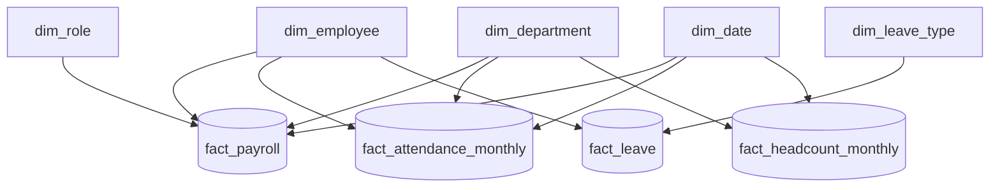

# PulseIQ Analytics Warehouse – Star Schema

## Fact Tables

### 1. fact_payroll
- Grain: One row per payroll item
- Measures: gross_pay, basic, hra, overtime_pay, variable_pay
- Dimensions: Employee, Department, Role, Date

### 2. fact_attendance_monthly
- Grain: One row per employee per month
- Measures: present_days, wfh_days, paid_leave_days, unpaid_absence_days, attendance_rate
- Dimensions: Employee, Department, Date

### 3. fact_leave
- Grain: One row per leave request
- Measures: days
- Dimensions: Employee, Leave Type, Start Date, End Date

### 4. fact_headcount_monthly
- Grain: One row per department per month
- Measures: headcount_end, hires, exits
- Dimensions: Department, Date

## Dimension Tables

- dim_employee: Employee details and historical versions (SCD Type 2)
- dim_department: Department details
- dim_role: Job role details
- dim_date: Calendar attributes
- dim_leave_type: Leave category details

## Relationships

- dim_employee → fact_payroll
- dim_department → fact_payroll
- dim_role → fact_payroll
- dim_date → fact_payroll
- dim_employee → fact_attendance_monthly
- dim_department → fact_attendance_monthly
- dim_date → fact_attendance_monthly
- dim_employee → fact_leave
- dim_leave_type → fact_leave
- dim_employee → fact_headcount_monthly (not directly stored in the current table)
- dim_department → fact_headcount_monthly
- dim_date → fact_headcount_monthly

## Data Quality Notes

- Employee history contains a source-record date overlap for EMP-0001.
- The source history does not contain a direct Sales-to-Customer-Support transfer.
- Attendance data is monthly-grain in the current source, not daily-grain.

## Star Schema Diagram

